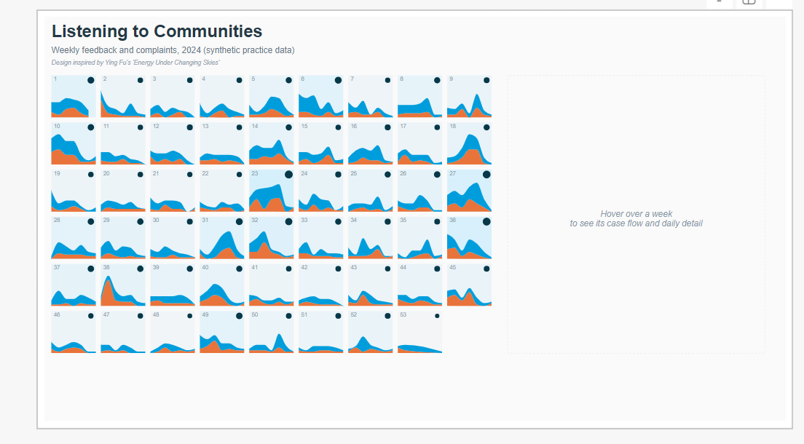

# Listening to Communities

**A year of community feedback and complaints on one screen, built in Power BI with Deneb (Vega).**



> ⚠️ **Synthetic data.** All figures in this repository come from AI-generated practice data. They do not describe any real programme, community or person.

---

## Overview

This dashboard shows a full year of community feedback and complaints, one week at a time. It is built to answer two questions that accountability and MEAL teams ask all the time:

- **When** does pressure build on our feedback and complaints mechanism?
- **How well** are we keeping up with it?

In the sample data, **5,034 feedback items** were logged in 2024 (about **95 a week**) along with **957 formal complaints**. **68%** of feedback was resolved on the spot, which left **2,553 cases** needing follow-up action.

---

## How to read it

### The weekly grid (left)

| Element | Meaning |
|---|---|
| **Each small box** | One week of the year, numbered 1–53. Read left to right, top to bottom, like a calendar. |
| **The shape inside** | Daily cases needing follow-up, Monday to Sunday. **Blue** is feedback referred to a programme or partner. **Orange** is formal complaints. A taller shape means more follow-up work that day. |
| **Background colour and dark circle** | How busy the week was. A **bluer background and bigger circle** mean more feedback came in. Pale boxes with small circles are quiet weeks. |

### The detail panel (right, appears on hover)

Hover over any week to open it.

**Flow diagram (Sankey).** This follows every case that came in that week:

```
Feedback Received ─┬─► Resolved on the Spot
                   └─► Referred for Action ─┐
                       Complaints ──────────┴─► Cases for Follow-up
```

Band thickness shows how many cases took each path. If the *Referred* band thickens over time, frontline staff are resolving fewer issues themselves.

*Example, week 27:* 183 feedback items came in and 126 were resolved on the spot (69%). The other 57 were referred, and together with 31 complaints that gave 88 cases for follow-up.

**Daily view.** The same week, day by day:
- **Bars** show the day's follow-up cases (blue = referrals, orange = complaints).
- **Circles** compare feedback received (navy) with feedback resolved on the spot (light blue). When the light circle nearly fills the navy one, almost everything was resolved that day.

---

## Insights the dashboard surfaces (sample data)

1. **Demand follows the distribution calendar.** Volumes spike in the first week of every month. Weekdays average about 17 items a day, Sundays about 3.
2. **Mid-year is the busiest period.** Weeks 23, 36 and 27 each had 180–194 items, almost double the weekly average. This matches the June–September scale-up of help desks.
3. **On-the-spot resolution improved.** The rate rose from **64% in the first half of the year to 73% in the second**, even though the second half was busier.
4. **Complaint surges are sudden.** Week 38 shows a single-day spike, a typical pattern after a distribution problem or incident. Weeks 10, 23 and 32 also passed 30 complaints.
5. **Rainy months are quieter.** April–May and October–November show lower volumes. That could mean lower need or lower access, and is worth checking.

### Possible actions
- Add hotline and help desk capacity in the first week of each month.
- Trigger a review when weekly complaints pass about 30 (about 1.5× the weekly average of 18).
- Keep investing in frontline resolution.
- Check access to feedback channels in the rainy season.

---

## Repository contents

| File | Description |
|---|---|
| `feedback_deneb_spec_v2.json` | The Vega specification to paste into the Deneb visual |
| `CFM_Feedback_Complaints_2024_synthetic.xlsx` | Synthetic daily dataset (366 rows) with a data dictionary sheet |
| `feedback_v2_preview.png` | Preview image of the dashboard |
| `README.md` | This file |

---

## Data

One row per day, 1 January – 31 December 2024.

| Column | Definition |
|---|---|
| `date` | Day the feedback or complaint was logged |
| `feedback_received` | Feedback logged through help desks, the hotline and suggestion boxes |
| `feedback_resolved` | Feedback closed at the point of contact the same day |
| `feedback_referred` | Feedback referred for action (= received − resolved) |
| `complaints_received` | Formal complaints logged |
| `cases_for_followup` | Cases needing follow-up (= referred + complaints) |

Two calculated columns are added in Power BI:

```dax
week = WEEKNUM ( feedback[date] )
weekday = WEEKDAY ( feedback[date], 2 )   -- Monday = 1 … Sunday = 7
```

---

## How to use it

### Requirements
- Power BI Desktop
- The **Deneb** custom visual (free, from AppSource)

### Steps
1. **Load the data.** Use *Get data → Excel workbook*, choose `CFM_Feedback_Complaints_2024_synthetic.xlsx` and load the sheet as a table named `feedback`.
2. **Add the calculated columns** `week` and `weekday` (see [Data](#data)).
3. **Add Deneb.** In the Visualizations pane, use *… → Get more visuals*, search for **Deneb** and add it.
4. **Add the fields.** Add these to the Deneb visual's *Values*, each set to **Don't summarize**:
   `week`, `weekday`, `feedback_received`, `feedback_resolved`, `feedback_referred`, `complaints_received`
5. **Paste the spec.** Open the visual's menu, choose *Edit*, select **Vega** with the **[empty]** template, paste the contents of `feedback_deneb_spec_v2.json` and press **Ctrl + Enter**.
6. **Fit the page.** Stretch the visual to fill the canvas. Under *Format visual → General*, turn off the title, background and border and set padding to 0. The layout and font sizes adjust to the visual's size.

### Using your own data
Replace the field names in the spec with your own (e.g. with *Ctrl + H* in the Deneb editor) and update the Sankey labels in the `nodes` data. Keep the same relationships so the flows balance:
- received = resolved + referred
- follow-up = referred + complaints

---

## Notes and limitations

- **Synthetic data.** This version is built to show how the dashboard works, not to report real results.
- **Week 53 has only 3 days** (29–31 December), so it always looks quiet.
- **Weeks run Sunday to Saturday** (Excel `WEEKNUM`). Switch to ISO or fiscal weeks if needed.
- **Days with zero activity** show as flat lines.
- **Counts aren't outcomes.** The dashboard shows how many cases were handled, not whether people were satisfied with the response.

---

## Built with

- [Power BI Desktop](https://powerbi.microsoft.com/)
- [Deneb](https://deneb-viz.github.io), a custom Power BI visual by Daniel Marsh-Patrick
- [Vega](https://vega.github.io/vega/) (v6), a visualization grammar

## Credits

- **Design inspiration:** Ying Fu's *"Energy Under Changing Skies"*, a weekly portrait of solar and grid energy use built in Deneb. This project adapts the layout idea (weekly small multiples with a hover detail panel) to community feedback data. The Vega specification here was written separately.
- **Author:** Moses Okumu, Data Analytics & MEAL ([Moses Analytics](#))

## License

Add a license of your choice (e.g. MIT) before publishing.
